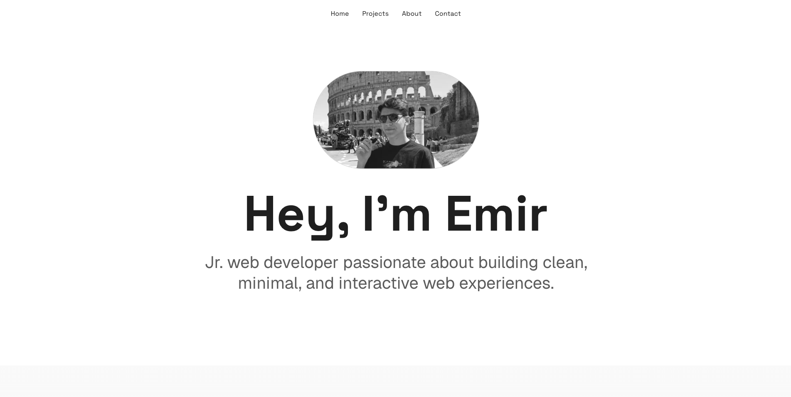
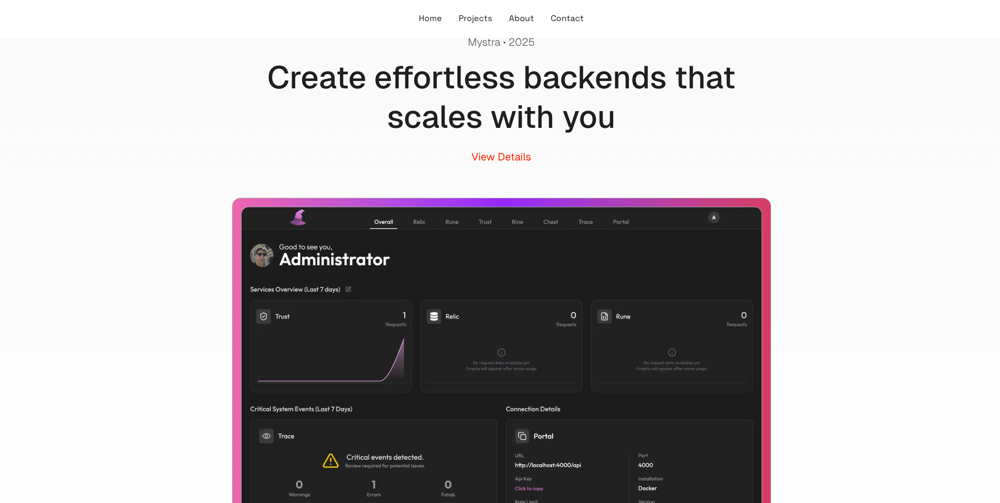
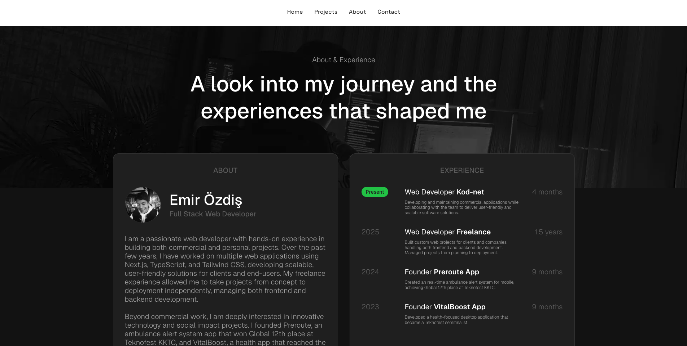
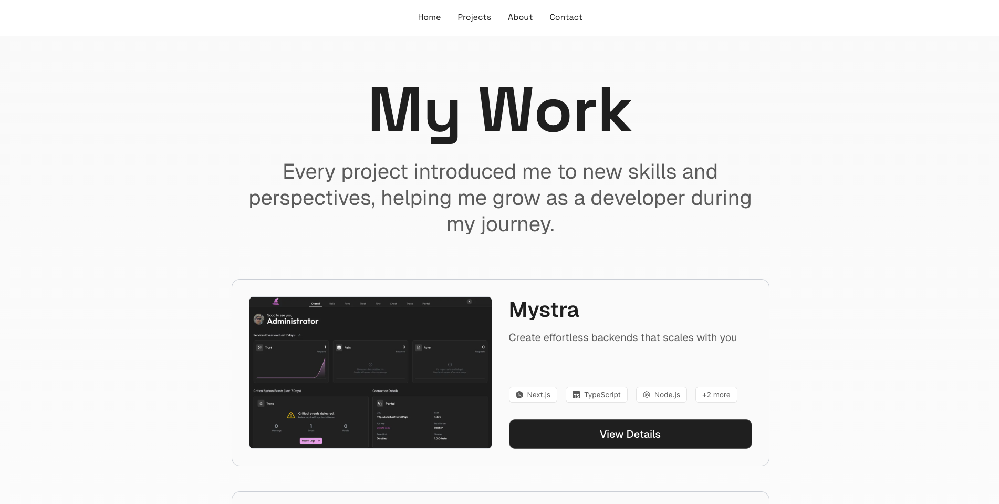

# Emir Özdiş - Personal Portfolio

Welcome to the official portfolio website of Emir Özdiş, a fullstack web developer. This site showcases my projects, skills, and professional experience, built with modern web technologies to provide a clean, minimal, and interactive user experience.

## Table of Contents

-   [About](#about)
-   [Features](#features)
-   [Tech Stack](#tech-stack)
-   [Installation](#installation)
-   [Usage](#usage)
-   [SEO & Performance](#seo--performance)
-   [Contact](#contact)
-   [License](#license)



## About

This portfolio serves as a comprehensive online presence for Emir Özdiş, highlighting his expertise in fullstack development. It features detailed descriptions of various projects, a professional overview of his experience, and an easy way to get in touch. The site is designed to be fast, responsive, and highly optimized for search engines.


## Features

-   **Interactive Hero Section**: Engaging introduction to Emir Özdiş.
-   **Dynamic Project Showcase**: Displays a curated selection of projects on the homepage and a dedicated "My Work" page.
-   **Detailed Project Pages**: Each project has its own page with in-depth descriptions, challenges faced, features, tech stack, and supporting images.
-   **Comprehensive About & Experience Section**: Outlines professional journey, roles, and key achievements.
-   **Integrated Contact Form/Scheduling**: Seamless integration with Cal.com for booking calls.
-   **Smooth Scrolling**: Enhanced user experience with `lenis` for fluid navigation.
-   **SEO Optimized**: Utilizes Next.js Metadata API, sitemap generation, and JSON-LD for improved search engine visibility.
-   **Responsive Design**: Built with Tailwind CSS to ensure a flawless experience across all devices.
-   **Modern UI/UX**: Clean, minimal, and interactive design.


## Tech Stack

-   **Frontend**: Next.js, React, TypeScript, Tailwind CSS, Lenis, next/font (Geist, Space Grotesk), React Icons, Cal.com Embed React
-   **Backend**: Next.js (API Routes/Server Components for data handling)
-   **Data Storage**: Local JSON/JS Objects (`src/lib/projectData.ts`)
-   **Deployment**: Vercel (implied)

## Installation

To get a local copy up and running, follow these simple steps.

### Prerequisites

-   Node.js (v18 or higher)
-   npm or yarn

### Steps

1.  **Clone the repository:**
    ```bash
    git clone https://github.com/emirozdis/emirozdis.com.git
    cd emirozdis.com
    ```
2.  **Install dependencies:**
    ```bash
    npm install
    # or
    yarn install
    ```
3.  **Run the development server:**
    ```bash
    npm run dev
    # or
    yarn dev
    ```
    Open [http://localhost:3000](http://localhost:3000) with your browser to see the result.

## Usage

This project is a personal portfolio. You can navigate through the different sections:
-   **Home**: Overview and featured projects.
-   **Projects**: A comprehensive list of all projects.
-   **About**: Learn more about Emir Özdiş's background and experience.
-   **Contact**: Schedule a call or get in touch.

## SEO & Performance

The website is highly optimized for performance and search engine visibility:
-   **Next.js**: Provides server-side rendering (SSR) and static site generation (SSG) capabilities for fast load times.
-   **Metadata API**: Custom `Metadata` objects are used in `layout.tsx` and individual pages for precise SEO control (titles, descriptions, Open Graph, Twitter cards).
-   **Sitemap Generation**: Dynamic sitemap (`src/app/sitemap.ts`) ensures all relevant pages are indexed.
-   **JSON-LD**: Structured data is embedded on project detail pages to enhance search engine understanding and rich snippets.
-   **Image Optimization**: Next.js `Image` component is used for efficient image loading and optimization.

## Contact

-   **Emir Özdiş**: [https://emirozdis.com](https://emirozdis.com)
-   **GitHub**: [https://github.com/emirozdis](https://github.com/emirozdis)

## License

Distributed under the MIT License. See `LICENSE` for more information. (Assuming MIT, or specify if another license is present)